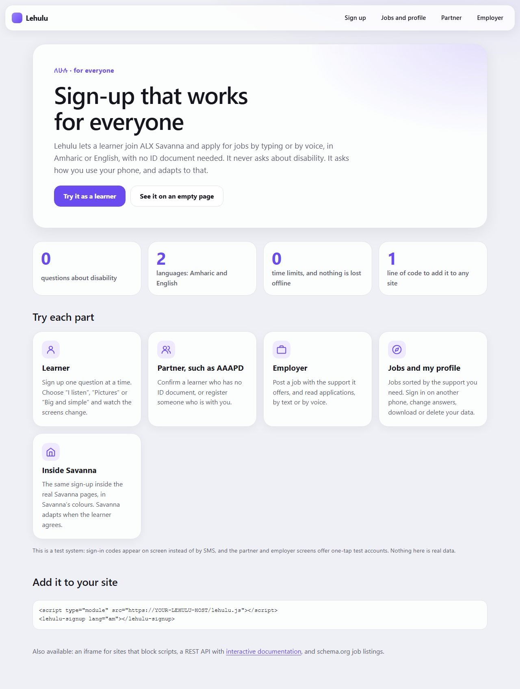
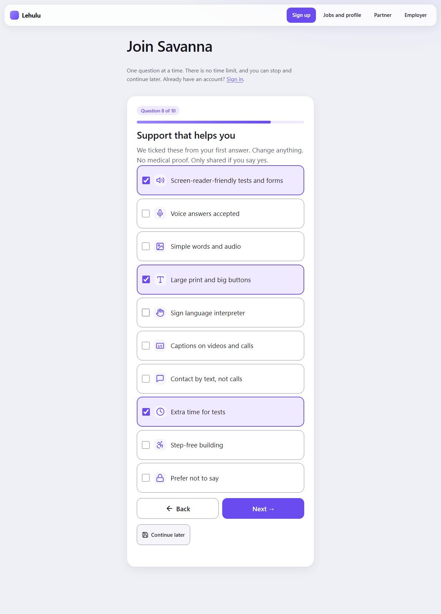
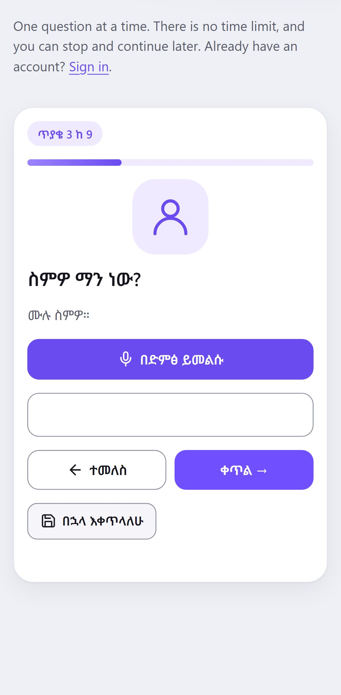
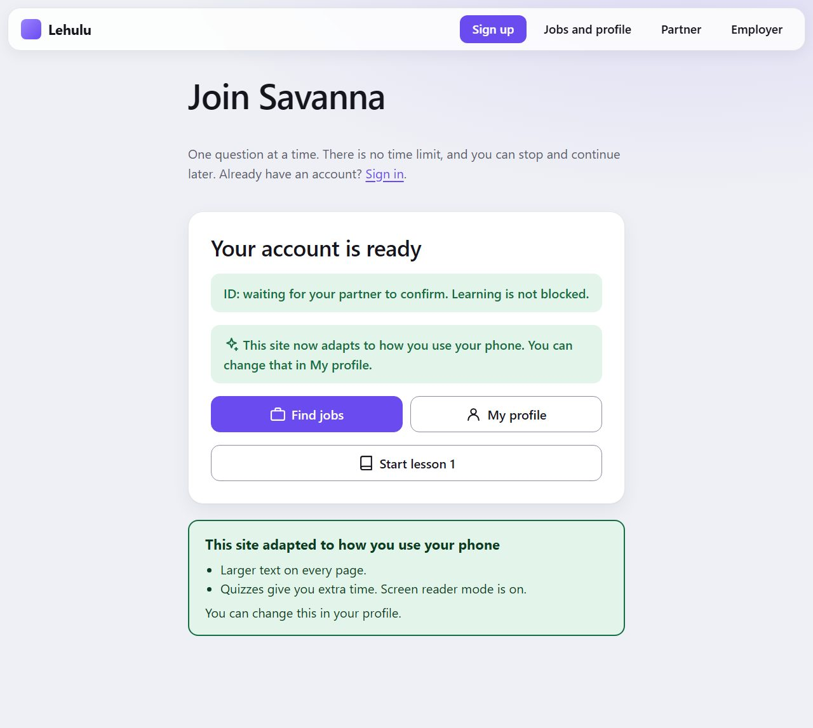
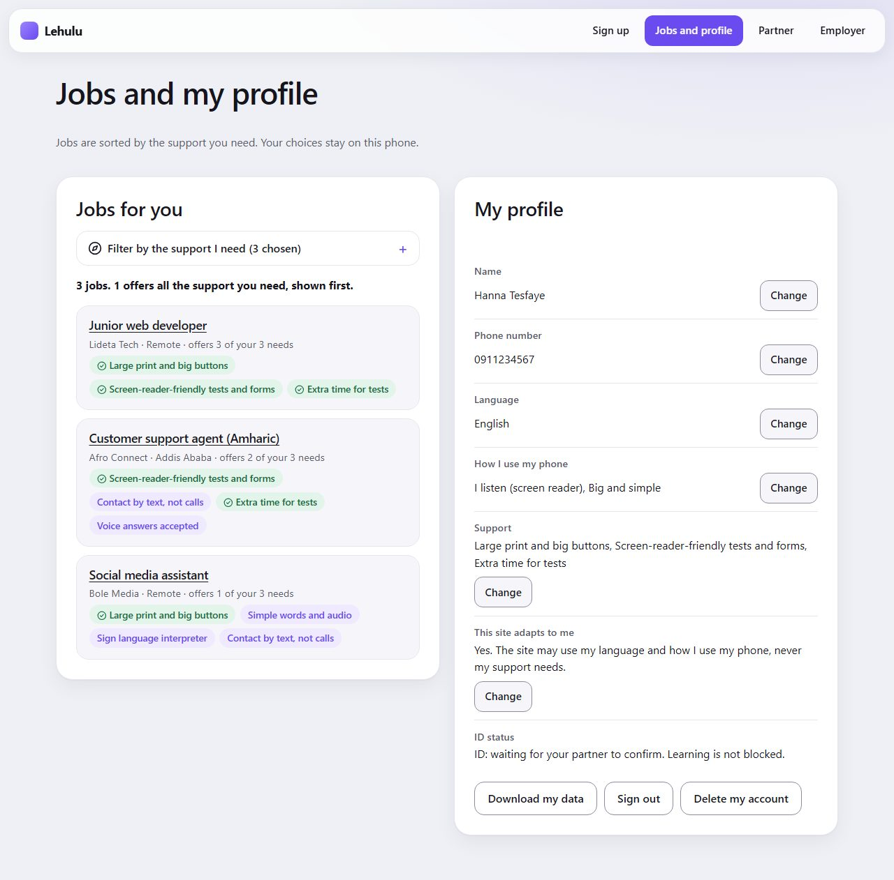
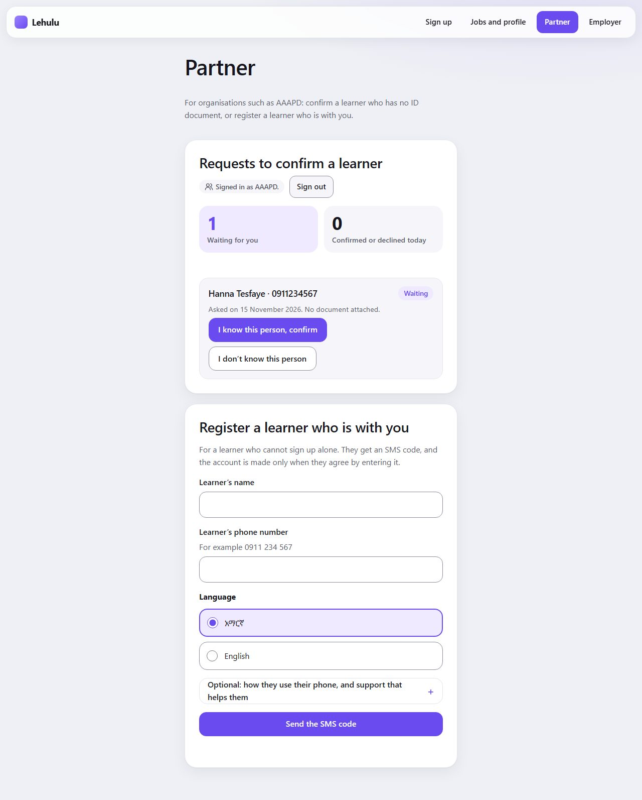
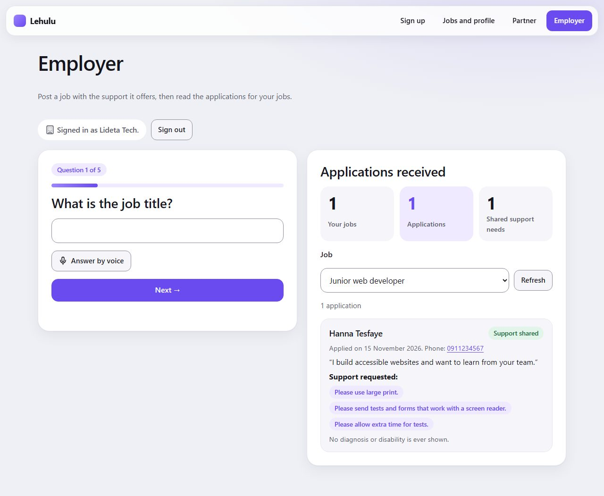
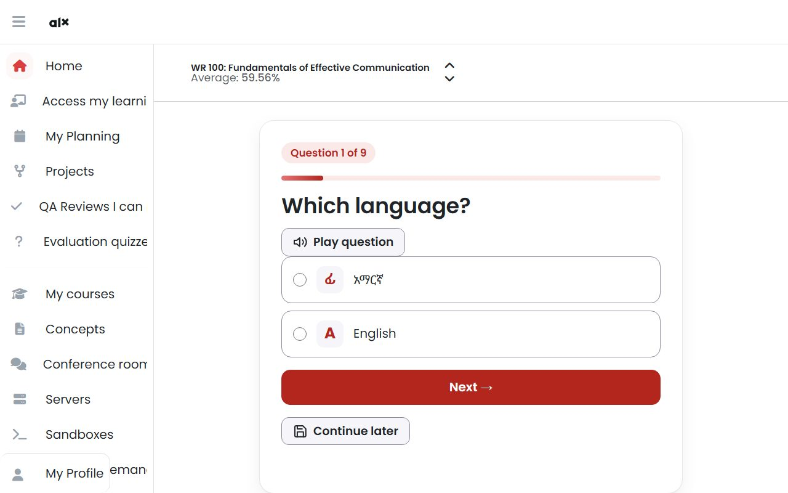

# Lehulu (ለሁሉ, "for everyone")

Track 1, Accessible onboarding · Digital Bridge Accessibility Hackathon 2026.
Team: _add names_ · Co-designer: _add name_



## What it does

Lehulu is a sign-up, profile and job-application module that any learning or job platform adds with one script
tag. A learner signs up one question at a time, by typing or by voice, in Amharic or English, without needing an
ID document. Instead of asking about disability, it asks how the learner uses their phone, adapts every screen to
that answer, and (only if the learner agrees) lets the host platform adapt too.

| Sign-up adapts to the learner | Amharic, by voice, on a phone | Success, and the site adapts |
|---|---|---|
|  |  |  |

| Jobs sorted by the support you need | Partner (AAAPD) | Employer |
|---|---|---|
|  |  |  |

Inside the real Savanna page, in Savanna's colours:



## The main task we tested

A blind learner with no kebele ID signs up in Amharic on a low-cost Android phone with TalkBack, has a partner
organisation confirm who they are, and applies for a job, with nobody helping.

## Run it

```bash
git clone https://github.com/kaleab-kali/lehulu.git
cd lehulu
docker compose up --build
```

Open **http://localhost:8080**. The front page links to every part; nothing else needs setting up. The first build
takes 5–10 minutes. `docker compose down -v` deletes all data; `PORT=8090 docker compose up` if 8080 is taken.

**This runs as a test system.** Two things in Lehulu normally need the outside world: a learner signing in on a
new phone gets a code by SMS, and partners and employers log in with a password their administrator gives them.
A laptop has neither, so on the test system the code is shown on screen, and the partner and employer screens
offer one-tap test accounts (**Continue as AAAPD**, **Continue as Lideta Tech**, …). Nothing needs switching.
To run it for real, set `DEMO_MODE=false` and connect an SMS provider (see [Going live](#going-live)); the test
accounts and on-screen codes then disappear.

| Page | What it is |
|---|---|
| http://localhost:8080/ | Front page: what Lehulu is, and a card for each part |
| http://localhost:8080/signup/ | Learner sign-up |
| http://localhost:8080/jobs/ | Jobs sorted by your support needs, and **My profile** (sign in, change, download, delete) |
| http://localhost:8080/partner/ | Partner screen (one tap: **Continue as AAAPD**) |
| http://localhost:8080/employer/ | Employer screen (one tap: **Continue as Afro Connect**, or another employer) |
| http://localhost:8080/blank.html | The module alone on an empty page with no host styles |
| http://localhost:8080/docs | Interactive API documentation |
| http://localhost:8080/savanna/ | Inside the real Savanna pages, after `bash scripts/import-savanna-starter.sh` |

### Walk through it

1. **Sign up** at `/signup/`. Choose a language, then **How do you use your phone?** (for example *I listen* and
   *Big and simple*). Give your name by typing or with **Answer by voice**. Try `123` as the phone number to see an
   error, then `0911 234 567`. For ID choose **No document. A partner can vouch for me** → **AAAPD**. Support is
   pre-ticked from your first answer; **Prefer not to say** is just as easy. Say yes to **Can the learning site
   adapt to you?** After **Create my account**, the card and the page both say what changed.
2. **Partner** at `/partner/`: **Continue as AAAPD**, play the learner's spoken name if they gave it by voice, and
   press **I know this person, confirm**. Or **Register a learner who is with you**: the learner gets a code and the
   account exists only once they enter it.
3. **Jobs** at `/jobs/`: jobs offering the support you need come first; the filter runs on the phone. Open a job and
   apply by text or voice, and choose whether *this employer only* sees your support needs.
4. **Employer** at `/employer/`: continue as the employer of that job (Junior web developer is Lideta Tech). Post a
   job with the support it offers, and read applications.
5. **Another phone**: open **My profile** in a private window, sign in with your phone number and the code shown on
   screen. On a shared phone you choose your account. Change any answer, **Download my data**, or **Delete my account**.
6. **Continue later**: stop half-way and press **Continue later**. The SMS has a link (`/signup/?resume=CODE`) that
   reopens your answers on any phone. Reloading or losing signal loses nothing.

## Install, Level 1: one script tag

```html
<script type="module" src="https://YOUR-LEHULU-HOST/lehulu.js"></script>
<lehulu-signup lang="am" jobs-url="/jobs" profile-url="/profile"></lehulu-signup>
```

The API is the server `lehulu.js` was loaded from. To use another server add `api="https://lehulu.example.org"`
(or `api-base`). That server must list your site in `ALLOWED_ORIGINS`.

| Element | What it is | Attributes |
|---|---|---|
| `<lehulu-signup>` | Sign-up; also the apply and post-a-job flows | `flow` (`signup` · `apply` · `employer`), `lang` (`am` · `en`), `job-id` (apply), `jobs-url`, `profile-url`, `theme` (`light` · `dark`), `api`, `focus-on-load` |
| `<lehulu-profile>` | Sign in by SMS code; see, change, download, delete | `lang`, `signup-url`, `api` |
| `<lehulu-jobs>` | Jobs with the private support filter, and apply | `lang`, `signup-url`, `profile-url`, `api` |
| `<lehulu-partner>` | Partner sign-in, confirm learners, register a learner | `lang`, `api` |
| `<lehulu-employer>` | Employer sign-in, post jobs, read applications | `lang`, `api` |
| `<lehulu-applications>` | Applications only (shows sign-in if needed) | `lang`, `api` |

Events (all bubble and cross the shadow root):

| Event | `detail` |
|---|---|
| `lehulu:step` | `{ flow, step, of, id }` |
| `lehulu:signup-complete` | `{ learnerId, idStatus, linkToken }` |
| `lehulu:signed-in` | `{ learnerId, linkToken }` |
| `lehulu:preferences` | `{ language, accessPreferences }`, only when the learner agreed. Never support needs |
| `lehulu:application-sent` | `{ jobId, supportShared }` |
| `lehulu:job-posted` | `{ job }` |
| `lehulu:start-lesson` | `{ learnerId }` |

Make your platform adapt in one line (this is what the Savanna demo does):

```html
<script type="module">
  import { adaptPage } from 'https://YOUR-LEHULU-HOST/lehulu.js';
  document.addEventListener('lehulu:preferences', (e) => adaptPage(e.detail, { jobsUrl: '/jobs' }));
</script>
```

**Linking accounts.** Send `linkToken` from `lehulu:signup-complete` to your own server, which exchanges it once
(within an hour) at `POST /v1/link` and gets the learner's id, name, phone, language and ID status, plus their
access preferences if they agreed. Create or link your own user with that.

**Theming:** the component reads Bootstrap's `--bs-body-font-family` and `--bs-body-color` when the host has them,
and `--lehulu-accent`, `--lehulu-soft`, `--lehulu-font`, `--lehulu-radius`, `--lehulu-scroll-offset` (height of a
fixed header) for everything else. Styles stay inside the shadow root.

**Iframe** for sites that block scripts:
`<iframe src="https://YOUR-LEHULU-HOST/embed/?flow=signup&lang=am" title="Lehulu sign-up" allow="microphone" style="width:100%;min-height:640px;border:0"></iframe>`
(`flow` = `signup`, `profile`, `jobs`, `partner`, `employer`).

## Install, Level 2: the API

- Spec: [`openapi.yaml`](openapi.yaml) (regenerate with `cd server && cargo run -- openapi ../openapi.yaml`).
  Live Swagger UI at `/docs`, JSON at `/openapi.json`.
- Errors always look like `{ "error": { "code": "phone_invalid", "message": "Enter 10 digits that start with 09 or 07, for example 0911 234 567.", "field": "phone" } }`.
- Learners use the `token` from sign-up or sign-in; partners and employers use OAuth 2.0 client credentials.
  Create real credentials with `lehulu create-client partner|employer <id> "<name>"`.

```bash
H=http://localhost:8080
# Learner: sign up (returns token and linkToken)
curl -s -X POST $H/v1/learners -H 'Content-Type: application/json' \
  -d '{"name":"Test Learner","phone":"0911234567","language":"am","idType":"later","accessPreferences":["listen"],"supportNeeds":["sr"],"shareWithHost":true}'
# Learner: sign in on another device
curl -s -X POST $H/v1/auth/code   -H 'Content-Type: application/json' -d '{"phone":"0911234567"}'
curl -s -X POST $H/v1/auth/verify -H 'Content-Type: application/json' -d '{"phone":"0911234567","code":"123456"}'
# Learner: own data (T = token)
curl -s $H/v1/me -H "Authorization: Bearer $T"
curl -s -X PATCH $H/v1/learners/$ID -H "Authorization: Bearer $T" -H 'Content-Type: application/json' -d '{"language":"en"}'
curl -s $H/v1/learners/$ID/export -H "Authorization: Bearer $T"
curl -s -X DELETE $H/v1/learners/$ID -H "Authorization: Bearer $T"
# Host server: link the learner to your own account
curl -s -X POST $H/v1/link -H 'Content-Type: application/json' -d '{"linkToken":"..."}'
# Autosave and continue later
curl -s -X POST $H/v1/drafts -H 'Content-Type: application/json' -d '{"flowId":"signup","stepIndex":2,"answers":{"language":"am"}}'
curl -s $H/v1/drafts/CODE
# Jobs (JSON or schema.org JobPosting)
curl -s $H/v1/jobs
curl -s $H/v1/jobs -H 'Accept: application/ld+json'
# Partner or employer token
curl -s -X POST $H/oauth/token -d 'grant_type=client_credentials&client_id=aaapd&client_secret=aaapd-demo'
curl -s $H/v1/partners/aaapd/vouches -H "Authorization: Bearer $P"
curl -s -X POST $H/v1/partners/aaapd/vouches/$ID -H "Authorization: Bearer $P" -H 'Content-Type: application/json' -d '{"decision":"confirm"}'
curl -s -X POST $H/v1/partners/aaapd/registrations -H "Authorization: Bearer $P" -H 'Content-Type: application/json' \
  -d '{"name":"Meron","phone":"0922345678","language":"am","accessPreferences":["sign"],"supportNeeds":["sign"]}'
curl -s -X POST $H/v1/jobs -H "Authorization: Bearer $E" -H 'Content-Type: application/json' -d '{"title":"Data entry clerk","supportOffered":["sr"]}'
curl -s $H/v1/jobs/job-web-dev/applications -H "Authorization: Bearer $E"
# Voice answers
curl -s -X POST $H/v1/media -H 'Content-Type: audio/webm' --data-binary @answer.webm
```

**Webhook.** Set `WEBHOOK_URL` (and `WEBHOOK_SECRET`). The server posts `{ "event", "at", "data" }` for
`learner.created`, `learner.deleted`, `application.created` and `id.decided`, signed in
`X-Lehulu-Signature: sha256=<HMAC-SHA256 of the body>`. The data holds ids and statuses only: never a name, phone
number, recording or support need.

## Install, Level 3: open standards

- **schema.org JobPosting:** `GET /v1/jobs` with `Accept: application/ld+json`.
- **LTI 1.3 (not built).** How it would connect: Lehulu registers as an LTI tool; Moodle or Canvas sends a signed
  OIDC launch to a new `/lti/launch` endpoint; Lehulu checks the platform's signature against its JWKS, maps the
  LTI `sub` to a learner with the same account-linking table used by `/v1/link`, and opens `<lehulu-profile>` or
  `<lehulu-signup>` already signed in. Until then the iframe works in any LMS without single sign-on.

## Languages and how to add one

Amharic and English everywhere: questions and errors in `flows/*.json`, screen words in
`web/src/engine/i18n.ts` and `web/src/engine/screens.ts`. Amharic text is marked `lang="am"` (so screen readers
switch voice) and gets a line height of 1.7. Strings still waiting for a native-speaker check are marked
`TODO(am-review)`.

To add a language (for example Afaan Oromo, `om`): add an `om` value next to `en`/`am` in each `flows/*.json`
label, copy the `en` blocks in `i18n.ts` and `screens.ts` to `om`, and add `om` to the `Lang` type and to the
server's `language` check (`server/src/routes/learners.rs`). Layout uses `gap` and flex, so right-to-left scripts
need no CSS changes.

## Offline and slow connection

Measured with Chrome's Slow 3G profile (400 kbit/s, high latency), empty cache, against the Docker build:

| Page | First question usable | Transferred |
|---|---|---|
| `/blank.html` (module only) | 8.6 s | 112 KB |
| `/signup/` (sign-up page) | 8.5 s | 116 KB |

`lehulu.js` is about 40 KB compressed (the server sends gzip or brotli). 74 KB is the Noto Sans Ethiopic font, cached
after the first visit. Videos and recordings never load until tapped; in "low data" mode sign clips wait for a tap.

Offline: every answer is kept on the phone as it is given, so a reload or a lost signal loses nothing, and voice
recordings wait on the phone until they can be uploaded. The learner is told in words ("Recording kept on this
phone. It will be sent when you are connected."). The Lehulu pages use a service worker (network first, cached
copy when offline). A sign-up cannot be *submitted* with no connection at all; it is sent when the learner taps
**Create my account** again online.

## Data and privacy

- **Collected:** name (typed or spoken), phone, language, Ethiopian date of birth, how the learner uses their
  phone, support needs (practical supports, never a diagnosis), ID route and optional ID number, applications.
  There is no disability field anywhere.
- **Stored:** SQLite (`data/lehulu.db`) and recordings in `MEDIA_DIR`, on the host's own server. ID numbers are
  encrypted (AES-256-GCM, key in `DATA_KEY` or `KEY_FILE`). Sign-in codes and tokens are stored only as hashes.
- **Who sees what:** the learner sees everything. An employer sees an applicant's name, phone and answer, and
  support needs only if the learner said yes for that job. A partner sees the name and phone of learners who chose
  them. The host platform gets language and access preferences only if the learner agreed, never support needs.
  Every consent is logged.
- **Export and delete:** **My profile → Download my data** (`GET /v1/learners/{id}/export`) and **Delete my account**
  (`DELETE /v1/learners/{id}`), which removes answers, applications, recordings and sessions.
- **Retention:** accounts unused for `RETENTION_DAYS` (default 365) are deleted with everything they hold; unused
  recordings after 2 days; unconfirmed partner registrations after 30 days.
- **No third parties:** no analytics, no cloud speech, no outside services at runtime.
- Test data only: seeded jobs, partners and employers are fictional.

## Cost to run

For 3,000 learners: one small VPS (1 vCPU, 1 GB RAM, 20 GB disk), about **US$5–7 a month**. One Docker container
(~170 MB image), SQLite, no paid services. Recordings are about 50–150 KB each, so under 1 GB for 3,000 learners.
The only variable cost is the SMS gateway (sign-in codes and "continue later" links), billed per message by the
chosen Ethiopian provider. Back up with `lehulu backup data/backup.db` plus the `MEDIA_DIR` folder and the key file.

## Going live

For ALX engineers putting Lehulu on Savanna for real, after the test system:

1. In `.env`: `DEMO_MODE=false`, `ALLOWED_ORIGINS=https://savanna.alxafrica.com` (your site), `PUBLIC_URL` (where
   Lehulu is served), and `DATA_KEY` (`openssl rand -hex 32`).
2. Connect an SMS provider in `server/src/adapters/sms.rs`, so sign-in codes and "continue later" links are texted.
3. Give each partner and employer their own login: `lehulu create-client partner aaapd "AAAPD"` prints an
   organisation ID and password, shown once.
4. Back up `data/` (database, recordings, key) with `lehulu backup`.

With `DEMO_MODE=false` the test accounts stop working, codes are never shown on screen, and `/dev/sms` is gone.

## Configuration

Server environment variables (see [`.env.example`](.env.example)):

| Variable | Default | Purpose |
|---|---|---|
| `DEMO_MODE` | `false` (`true` in Docker Compose) | Test system: one-tap test accounts, codes on screen, `/dev/sms` |
| `ALLOWED_ORIGINS` | empty | Sites allowed to call the API from the browser (comma-separated) |
| `PUBLIC_URL` | `http://localhost:8080` | Used in SMS links |
| `DATA_KEY` / `KEY_FILE` | empty / `data/lehulu.key` | Key that encrypts ID numbers |
| `WEBHOOK_URL` / `WEBHOOK_SECRET` | empty | Host webhook |
| `RETENTION_DAYS` | `365` | Delete unused accounts |
| `SMS_ADAPTER` | `simulator` | Real gateway adapter goes in `server/src/adapters/sms.rs` |
| `BIND`, `DATABASE_URL`, `PUBLIC_DIR`, `FLOWS_DIR`, `SEED_DIR`, `MEDIA_DIR` | see `server/src/config.rs` | Paths |

Server commands: `lehulu serve` (default) · `seed` · `create-client partner|employer <id> [name]` ·
`backup <file>` · `openapi [file]` · `healthcheck`.

Recorded question prompts and sign clips: put them in `web/public/audio/<lang>/<step>.opus` and
`web/public/sign/<step>.webm` and list the step ids in `web/public/media.json` (see `docs/RECORDING.md`).
Until then **Play question** uses the phone's own voice where one exists for the language, and is hidden otherwise.

## Development and tests

Needs Node 22+ with pnpm, and Rust 1.80+ for the server.

```bash
cd web && pnpm install && pnpm exec playwright install chromium
pnpm dev                       # demo mode, data in the browser, http://localhost:5173
cd server && cargo run         # API on :8080 (then: cd web && pnpm dev:api)
```

| What | Command |
|---|---|
| Type check | `cd web && pnpm typecheck` |
| Web unit tests | `cd web && pnpm test` |
| End-to-end + axe, demo mode | `cd web && pnpm exec playwright test` |
| End-to-end + axe against a server | `cd web && BASE_URL=http://localhost:8080 pnpm exec playwright test` (server with `DEMO_MODE=true`) |
| Rust tests | `cd server && cargo test` |
| Rust lint | `cd server && cargo fmt --check && cargo clippy --all-targets -- -D warnings` |
| Against Docker | `docker compose --profile test run --rm test` |

The end-to-end suite does every journey with the keyboard only and runs axe on every screen (fails on any serious
or critical issue), on a desktop and a phone viewport, including inside the real Savanna page and on the blank
page.

```
web/      components (src/components), flow engine (src/engine), data layer (src/data/store.ts), tests
server/   Rust API: routes, auth, domain rules, migrations, seed data
flows/    signup.json, apply.json, employer.json, needs.json (shared by web and server)
scripts/  import-savanna-starter.sh
docs/     ARCHITECTURE.md, FEATURES.md, CONFORMANCE.md, RECORDING.md
```

## Finished and not finished

**Finished:** everything in the walkthrough above, with automated tests (26 Rust, 8 unit, and 10 end-to-end journeys each
run on a desktop and a phone viewport, in demo mode and against the server). Status per feature: [docs/FEATURES.md](docs/FEATURES.md).

**Not finished:**
- Recorded Amharic question prompts and Ethiopian Sign Language clips (people must record them).
- Native-speaker review of the Amharic (`TODO(am-review)`).
- The conformance report needs the co-designer's TalkBack and NVDA sessions ([docs/CONFORMANCE.md](docs/CONFORMANCE.md)).
- A real SMS gateway adapter (the simulator is built; production needs a provider's API key).
- Speech-to-text is not used: voice recordings are kept as the answer, which works in Amharic and offline.
- LTI 1.3 (see Level 3).

## Libraries and their licences

Web: lit (BSD-3-Clause), @fontsource/noto-sans-ethiopic (OFL-1.1). Build and test only: Vite, Vitest (MIT),
TypeScript, Playwright (Apache-2.0), @axe-core/playwright (MPL-2.0).
Server: axum, tokio, tower, tower-http, hyper, tracing (MIT); sqlx, serde, serde_json, utoipa, utoipa-swagger-ui
(Swagger UI is Apache-2.0), chrono, uuid, rand, sha2, hmac, aes-gcm, hex, reqwest, rustls, thiserror (MIT or
Apache-2.0); ring (ISC-style).

## Licence

See [LICENSE](LICENSE).
