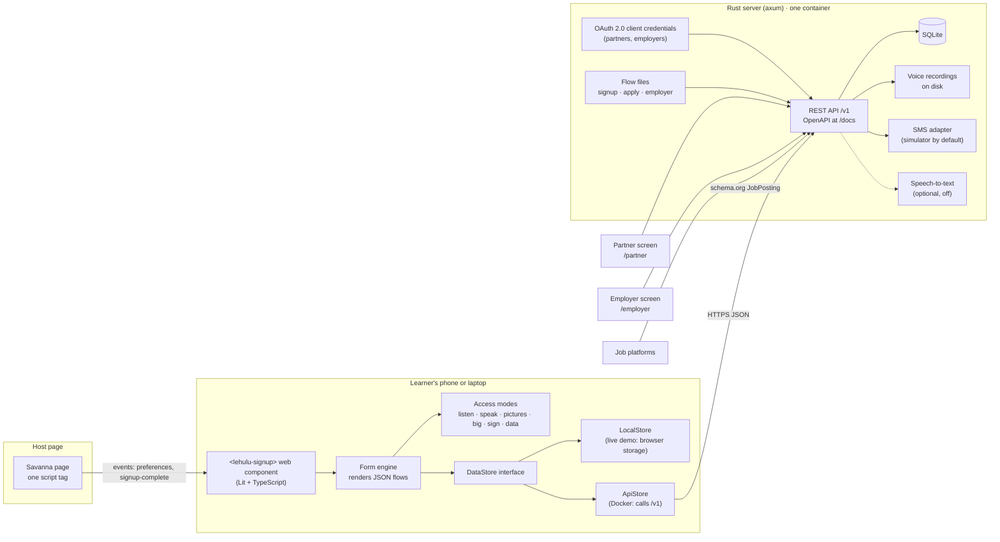

# Lehulu architecture

## 1. The big picture

One core, three doors (as in the hackathon training): a **web component** for any site, a **REST API** for partner apps, and **standard job data** for job platforms. All three share one form engine and one database.



### Design rules
1. **Native HTML first.** Real `<button>`, `<input>`, `<fieldset>`, `<label>`. ARIA only for live messages and linking errors.
2. **One question per screen**, autosaved after each answer. No timers anywhere.
3. **Flows are data, not code.** Sign-up, job application and employer form are JSON files read by one renderer. A new flow needs no new UI code.
4. **Modes change presentation, never content.** Every mode shows the same questions. Audio and sign clips always have on-screen text, so sound-off still works.
5. **Store needs, never diagnoses.** No disability field exists in the database.
6. **No outside services.** Everything runs offline in one container. SMS and speech-to-text sit behind adapters.

---

## 2. Repository structure

```
lehulu/
├── README.md · LICENSE · Dockerfile · docker-compose.yml · .env.example
├── .github/workflows/
│   ├── ci.yml                 # cargo fmt/clippy/test · typecheck · unit · Playwright + axe · docker build
│   └── pages.yml              # live demo on GitHub Pages, published only if the axe tests pass
├── docs/                      # ARCHITECTURE · FEATURES (tracker) · CONFORMANCE · RECORDING
├── scripts/import-savanna-starter.sh   # puts Lehulu inside the real Savanna starter pages
├── flows/                     # shared by web and server
│   ├── signup.json · apply.json · employer.json
│   └── needs.json             # the shared list of needs (learner ↔ employer) + ways → needs
├── web/
│   ├── index.html             # demo host page (Savanna-like, fixed top bar)
│   ├── jobs/ · partner/ · employer/ · embed/   # pages for the other screens and the iframe version
│   ├── public/audio/{am,en}/  # recorded prompts <step-id>.opus (by people, see docs/RECORDING.md)
│   ├── public/sign/           # interpreter clips <step-id>.webm
│   ├── src/
│   │   ├── lehulu.ts          # the one script: registers all custom elements
│   │   ├── pages.ts · pages.css   # demo host pages only
│   │   ├── components/
│   │   │   ├── lehulu-signup.ts       # renders ANY flow: signup, apply, employer
│   │   │   ├── lehulu-jobs.ts         # private filter + list + apply
│   │   │   ├── lehulu-partner.ts      # confirm learners without ID
│   │   │   ├── lehulu-applications.ts # what the employer receives
│   │   │   ├── lehulu-profile.ts      # view + delete (edit: F12)
│   │   │   └── styles.ts              # shared, themeable, light/dark
│   │   ├── engine/            # flow.ts · validators.ts · modes.ts · i18n.ts · recorder.ts · fonts.ts · assets.ts · types.ts
│   │   ├── lib/ethiopian-calendar.ts
│   │   └── data/store.ts      # DataStore · ApiStore (Docker) · LocalStore (live demo) · session
│   ├── tests/unit/            # Vitest
│   ├── tests/e2e/             # Playwright: keyboard-only main task + axe on every screen
│   ├── vite.config.ts         # pages build
│   └── vite.lib.config.ts     # lehulu.js for other sites
└── server/
    ├── Cargo.toml · Cargo.lock
    ├── migrations/0001_init.sql
    ├── seed/jobs.json · partners.json
    └── src/
        ├── main.rs            # serve | healthcheck | seed
        ├── config.rs · db.rs · error.rs · openapi.rs
        ├── routes/            # flows · drafts · learners · jobs · applications · partners · dev (SMS page) · tests in mod.rs
        ├── domain/            # validate · ethiopian_calendar · needs
        └── adapters/          # sms (simulator) · stt (stub, off)
```

## 3. Form engine: flow file format

```json
{
  "id": "signup",
  "version": 1,
  "steps": [
    {
      "id": "ways", "type": "checks", "icon": "phone",
      "title": { "am": "ስልክዎን እንዴት ይጠቀማሉ?", "en": "How do you use your phone?" },
      "hint":  { "am": "...", "en": "Choose any. We never ask about your disability." },
      "options": [
        { "value": "listen", "icon": "speaker", "label": { "am": "...", "en": "I listen (screen reader)" } }
      ],
      "audio": "audio/{lang}/ways.opus",
      "sign": "sign/ways.webm"
    },
    {
      "id": "phone", "type": "tel", "autocomplete": "tel",
      "validate": [{ "rule": "et_phone", "message": { "en": "Enter 10 digits that start with 09 or 07, for example 0911 234 567." } }]
    },
    {
      "id": "idnum", "type": "text", "optional": true,
      "when": { "field": "id", "in": ["kebele", "refugee", "other"] }
    }
  ]
}
```

Step types: `text`, `tel`, `choice`, `checks`, `et-date`, `audio-answer`, `review`, `info`.
The server validates with the **same rules** (`et_phone`, `required`, `et_date`), so the web and API never disagree.

Sign-up step ids: `language`, `ways`, `name`, `phone`, `dob`, `idType`, `idNumber` (when kebele/refugee/other), `partner` (when partner), `supportNeeds`, `review`.

---

## 4. Data model (SQLite)

Source of truth: `server/migrations/0001_init.sql` (embedded in the binary, run on start).

```sql
-- Lehulu schema. There is deliberately no disability or diagnosis column anywhere.

CREATE TABLE learners (
  id TEXT PRIMARY KEY,
  name TEXT NOT NULL,
  phone TEXT NOT NULL,
  language TEXT NOT NULL CHECK (language IN ('am', 'en')),
  dob_eth_y INTEGER, dob_eth_m INTEGER, dob_eth_d INTEGER,
  access_preferences TEXT NOT NULL DEFAULT '[]',
  id_type TEXT NOT NULL CHECK (id_type IN ('kebele', 'refugee', 'other', 'partner', 'later')),
  id_number TEXT,                 -- optional; TODO(F21): encrypt at rest
  partner_id TEXT REFERENCES partners(id),
  id_status TEXT NOT NULL CHECK (id_status IN ('not_given', 'not_checked', 'waiting_partner', 'confirmed_by_partner')),
  created_at TEXT NOT NULL,
  updated_at TEXT NOT NULL
);

-- Separate table so access can be limited to the learner and support roles.
CREATE TABLE support_needs (
  learner_id TEXT NOT NULL REFERENCES learners(id) ON DELETE CASCADE,
  need TEXT NOT NULL,
  PRIMARY KEY (learner_id, need)
);

CREATE TABLE drafts (
  resume_code TEXT PRIMARY KEY,
  flow_id TEXT NOT NULL,
  step_index INTEGER NOT NULL,
  answers TEXT NOT NULL,
  updated_at TEXT NOT NULL
);

CREATE TABLE partners (
  id TEXT PRIMARY KEY,
  name TEXT NOT NULL,
  client_id TEXT UNIQUE,
  client_secret_hash TEXT
);

CREATE TABLE vouches (
  learner_id TEXT NOT NULL REFERENCES learners(id) ON DELETE CASCADE,
  partner_id TEXT NOT NULL REFERENCES partners(id),
  status TEXT NOT NULL CHECK (status IN ('requested', 'confirmed', 'declined')),
  requested_at TEXT NOT NULL,
  decided_at TEXT,
  PRIMARY KEY (learner_id, partner_id)
);

CREATE TABLE jobs (
  id TEXT PRIMARY KEY,
  title TEXT NOT NULL,
  org TEXT NOT NULL,
  city TEXT,
  remote INTEGER NOT NULL DEFAULT 0,
  created_at TEXT NOT NULL
);

CREATE TABLE job_support (
  job_id TEXT NOT NULL REFERENCES jobs(id) ON DELETE CASCADE,
  need TEXT NOT NULL,
  PRIMARY KEY (job_id, need)
);

CREATE TABLE applications (
  id TEXT PRIMARY KEY,
  job_id TEXT NOT NULL REFERENCES jobs(id),
  learner_id TEXT NOT NULL REFERENCES learners(id) ON DELETE CASCADE,
  why_text TEXT,
  why_audio_path TEXT,
  support_shared INTEGER NOT NULL,
  created_at TEXT NOT NULL
);

CREATE TABLE consent_log (
  id INTEGER PRIMARY KEY AUTOINCREMENT,
  learner_id TEXT,
  actor TEXT NOT NULL,
  action TEXT NOT NULL,
  at TEXT NOT NULL
);
```

---

## 5. API (v1) — as built

| Method | Path | What | Auth (F13) |
|---|---|---|---|
| GET | `/v1/flows/{id}` | A flow JSON (`signup`, `apply`, `employer`, `needs`) | public |
| POST | `/v1/drafts` | Start autosave, returns `resumeCode`; `sendLinkTo` sends an SMS | learner |
| PUT / GET | `/v1/drafts/{code}` | Autosave after each question / resume | learner |
| POST | `/v1/learners` | Create account from the finished flow | learner |
| GET / PATCH / DELETE | `/v1/learners/{id}` | Profile, edit, delete (right to erasure) | learner |
| GET | `/v1/learners/{id}/preferences` | Language + access preferences only, for the host | host, with consent (F19) |
| GET | `/v1/jobs` | Jobs + support offered; `Accept: application/ld+json` → schema.org JobPosting | public |
| POST | `/v1/jobs` | Post a job with support offered | employer token |
| GET | `/v1/jobs/{id}/applications` | Applications; support needs only where the learner said yes | employer token |
| POST | `/v1/applications` | Apply (text now; voice upload in F8) | learner |
| GET | `/v1/partners` | Partner list | public |
| GET | `/v1/partners/{id}/vouches` | Learners waiting for confirmation | partner token |
| POST | `/v1/partners/{id}/vouches/{learnerId}` | `{ "decision": "confirm" \| "decline" }` | partner token |
| GET | `/healthz` · `/openapi.json` · `/docs` · `/dev/sms` | Health, spec, Swagger UI, SMS simulator | — |

Every error: `{ "error": { "code": "...", "message": "plain words + how to fix", "field": "..." } }`

## 6. Key flows

**Sign-up with autosave**
1. The component loads `signup.json` and renders step 1.
2. After each **Next**, the client validates, then `PUT /v1/drafts/{code}` (in demo mode: browser storage).
3. Focus moves to the next question heading, so the screen reader reads “Question 4 of 9. …”.
4. On the review screen, **Create my account** → `POST /v1/learners`. The draft is deleted.
5. The component fires `lehulu:signup-complete` and `lehulu:preferences` to the host page.

**Partner vouch**
1. Learner picks “No document, a partner can vouch for me” + AAAPD → a `vouches` row with status `requested`. `id_status = waiting_partner`. Learning is not blocked.
2. The AAAPD officer opens `/partner` → `GET /v1/partners/aaapd/vouches`.
3. **I know this person** → `POST …/vouches/{id}` → `confirmed_by_partner`. A consent-log entry is written.

**Apply with private support**
1. The job list filters on the phone using the learner’s needs. Needs are not sent to the server for filtering.
2. The application reuses name and phone (WCAG 3.3.7).
3. The learner chooses whether to share. `support_shared` is stored per application.
4. The employer API returns needs only for applications where the learner said yes.

---

## 7. Accessibility architecture

| Concern | Where it lives |
|---|---|
| Focus after each step, error and confirmation | `engine/focus.ts`: one function used by every screen |
| Errors announced | `role="alert"` element linked by `aria-describedby`, field gets `aria-invalid` |
| Saved / result count / “we heard” messages | `role="status"` |
| Amharic inside an English host page | `lang="am"` on the component root or on each Amharic string |
| Modes | `engine/modes.ts` turns ways into flags. Components read flags. No mode removes text. |
| Fixed Savanna top bar (WCAG 2.4.11) | `scroll-margin-top` on focus targets |
| Targets | 44 px minimum, 60 px in “big” mode |
| Regression guard | Playwright runs the main task in every mode and axe on every screen, in CI and before every live-demo publish |

## 8. Privacy (Proclamation No. 1321/2024)
- No disability or diagnosis field. Needs are a fixed list of practical supports.
- ID number optional and encrypted at rest. No document images.
- Support needs leave the server only to an employer the learner chose, per application.
- Consent log for partner actions. `DELETE /v1/learners/{id}` removes everything (cascade).
- No analytics or third-party scripts. Retention set by `RETENTION_DAYS`.

---

## 9. Build order: features step by step

**Live status is in [FEATURES.md](FEATURES.md).** The scaffold already includes F0–F6, F10, F11, F14, F15, F19, F20 and F22.

Estimates are for a person working with an AI coding assistant, including review and a TalkBack check. **Done** means it passes keyboard, NVDA or TalkBack, and axe.

| # | Feature | Owner | Depends on | Est. | Done when |
|---|---|---|---|---|---|
| F0 | Repo, CI, Pages workflow, Savanna page with script tag | D | — | 1 h | Empty component shows on the live link |
| F1 | Flow file format + `needs.json` + `signup.json` | B + A | — | 0.5 h | Team agrees, both sides load it |
| F2 | Question screen: heading, hint, text/tel, errors, Back/Next, focus | B | F1 | 2 h | TalkBack reads question, label, error |
| F3 | Choice, checks, Ethiopian-calendar date, review with Change | B | F2 | 2 h | Main sign-up completes by keyboard |
| F4 | `DataStore` with LocalStore, autosave + continue later | B | F2 | 1 h | Reload keeps answers; no timers |
| F5 | Server skeleton: config, errors, SQLite, migrations, healthcheck, Docker | A | — | 1.5 h | `docker compose up` serves the page |
| F6 | Learners + drafts API, OpenAPI `/docs` | A | F5 | 1.5 h | Sign-up saved in SQLite through ApiStore |
| F7 | Access modes: listen, big, speak (voice-first) | B | F3 | 2 h | Same flow behaves differently per first answer |
| F8 | Voice button (MediaRecorder, read-back, edit) + upload | B + A | F2, F6 | 1.5 h | Recording saved; text editable |
| F9 | Pictures mode + play button + recorded Amharic prompts | C | F7 | 2 h | Low-literacy path works with and without sound |
| F10 | ID routes + partner vouch API + partner screen | A + C | F6 | 2 h | Vouch request confirmed from `/partner` |
| F11 | Support needs pre-ticked from ways | B | F7 | 0.5 h | Needs match first answer, editable |
| F12 | Profile view: edit, add ID later, delete | B + A | F6 | 1.5 h | Change one answer and it saves |
| F13 | Jobs API + JSON-LD + employer form + OAuth token | A | F6 | 2 h | Posted job appears in learner list; JSON-LD validates |
| F14 | Job list with on-device filter + live count | B | F13 | 1 h | Count announced; titles are headings |
| F15 | Apply flow (reuse engine), share yes/no, employer view | B + A | F8, F13 | 1.5 h | Employer sees needs only when shared |
| F16 | Sign mode: interpreter clips, lazy-load in data-saver | C | F7 | 1.5 h | Clip per sign-up question, text always shown |
| F17 | Amharic interface + `lang` attributes | C | F3 | 1 h | NVDA switches voice on Amharic |
| F18 | SMS simulator + “continue later” link + partner register-with-consent | A | F6 | 1.5 h | Code at `/dev/sms` completes consent |
| F19 | Host events (`lehulu:preferences`) shown on Savanna page | B | F7 | 0.5 h | Savanna page enlarges text when “big” chosen |
| F20 | Playwright main task in every mode + axe gate | D | F3 → | 3 h (rolling) | CI red on any serious/critical issue |
| F21 | README, conformance report, pitch deck, cold install test | D | all | 3 h | A stranger installs from README in < 1 h |
| — | Stretch: voice-only mode, speech-to-text (whisper-rs), offline queue, Telegram | — | — | — | Only after F0–F21 pass |

**Must-have path (fail the gate or miss a requirement without it):** F0–F15, F20, F21 ≈ 30 h.
**Should-have:** F16–F19 ≈ 4.5 h.
**Total ≈ 34 person-hours of building.** Plan for about 45 with fixes from co-designer tests. Four people have about 50 build hours across the two days, so it fits only if the stretch list stays cut.
